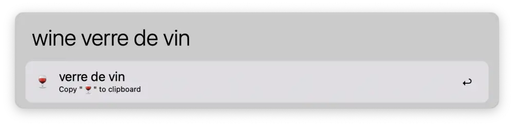
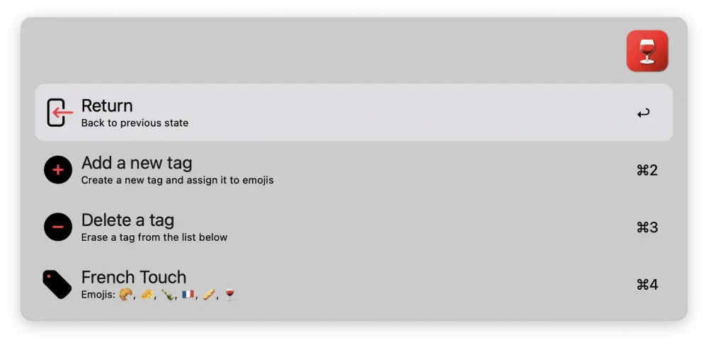
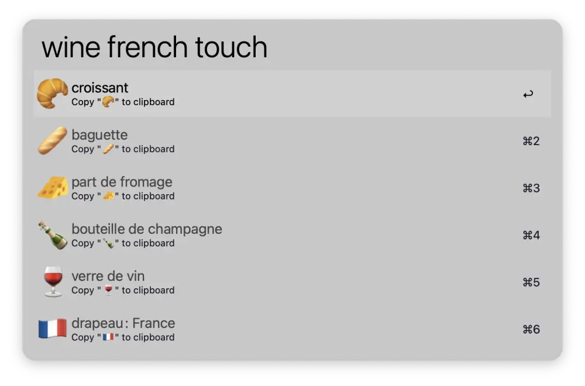

[](https://github.com/BenjaminOddou)
[](https://saythanks.io/to/BenjaminOddou)
[](https://www.python.org/downloads/macos/)

Welcome to the Alfred Emoji Wine repository: **An Alfred Workflow** ✨

## ✅ Prerequisites

* MacOS.
* **Alfred 6**. Note that the [Alfred Powerpack](https://www.alfredapp.com/powerpack/) is required to use workflows. Alfred 5.5 still runs the workflow, without the [Alfred 6 extras](#-alfred-6).
* Requires **python 3.8** or above (the one shipped with the Xcode Command Line Tools is fine).
* No other dependency: icons are rendered with the tools built into macOS (no more Pillow).

## 🏎️ Data sources

This workflow combines multiple sources (see below) to build a local JSON API (`~/Library/Caches/com.runningwithcrayons.Alfred/Workflow Data/com.benjamino.emoji_wine`) along with an icons folder with png images. Emoji icons are rendered once with the macOS built-in AppKit (through `osascript`) using Apple Color Emoji, and are reused on the next refreshes (they only change when you change the padding).

The search results are prepared once in a search index next to it (`search.index`, rebuilt when the settings, the API or the tags change) : at each keystroke the workflow only compares words and copies ready-made results.

List of sources :
* [Full list of latest emojis](https://unicode.org/Public/emoji/latest/emoji-test.txt) - Used to grab the full list of emojis.
* [CLDR Data files annotations](https://github.com/unicode-org/cldr/tree/main/common/annotations) - Used to translate emojis titles and tags.
* [CLDR Data files annotations derived](https://github.com/unicode-org/cldr/tree/main/common/annotationsDerived) - Used to translate emojis titles and tags.

## ⬇️ Installation

1. [Download the workflow](https://github.com/BenjaminOddou/alfred-emoji-wine/releases/latest)
2. Double click the `.alfredworkflow` file to install

## 🧰 Setup the workflow

Check that Python 3.8 or above is installed :

```shell
python3 --version
```

That's it, nothing else to install. If `python3` is missing, run `xcode-select --install`.

### 🆕 Alfred 6

The workflow uses what Alfred 6 brings to workflows:

* **Native notifications** : Alfred posts them itself (*Post Notification* output, macOS UserNotifications). The Notificator helper app is gone, the old copy is removed from the cache at the next refresh.
* **Menu always on top** (`skipknowledge`) : results keep the workflow order, so **Tags**, **API information** and **Refresh the API** always come first. Results have no `uid` anymore : Alfred doesn't reorder them with what it learnt.
* **Strict modifier keys** (`strictmods`) : a shortcut you deactivated (or <kbd>⇧</kbd><kbd>⏎</kbd> on an emoji without dictionary page, any modifier on a menu row) does nothing, instead of running the <kbd>⏎</kbd> action by surprise.
* **Icons keep their shape** (`iconresize`).

## 🧙‍♂️ Invoke the workflow

Everything goes through a single keyword : `wine`.

1. Type `wine` (optionally followed by your search) and press <kbd>⏎</kbd> to search emojis.
2. **Tags**, **API information** and **Refresh the API** are always pinned at the top of the results (while you type, they only stay if their name matches, so <kbd>⏎</kbd> never refreshes by accident). You can also start the query with `>` to open the menu.

On the very first run, `wine` shows **No API detected** : press <kbd>⏎</kbd> to download the emojis in your language.

You can edit the keyword (flagged with a `🕹️` symbol) in the user configuration panel.

## 🤖 Usage of the workflow

### Setup variables

1. `🌐 Language` : select the language you prefer. Here is the full list of supported languages :

| **Language**       | **ISO639-1** | **EmojiPedia** | **EmojiTerra** | **EmojiAll** |
|--------------------|--------------|----------------|----------------|--------------|
| 🇬🇧 English       | en           | 🟢             | 🟢             | 🟢           |
| 🇫🇷 Français      | fr           | 🟢             | 🟢             | 🟢           |
| 🇪🇸 Español       | es           | 🟢             | 🟢             | 🟢           |
| 🇵🇹 Português     | pt           | 🟢             | 🟢             | 🟢           |
| 🇮🇹 Italiano      | it           | 🟢             | 🟢             | 🟢           |
| 🇩🇪 Deutsch       | de           | 🟢             | 🟢             | 🟢           |
| 🇳🇱 Nederlands    | nl           | 🟢             | 🔴             | 🟢           |
| 🇳🇴 Norsk         | no           | 🟢             | 🔴             | 🔴           |
| 🇸🇪 Svenska       | sv           | 🟢             | 🔴             | 🟢           |
| 🇩🇰 Dansk         | da           | 🟢             | 🔴             | 🟢           |
| 🇮🇩 Melayu        | ms           | 🟢             | 🔴             | 🟢           |
| 🇸🇦 ٱلْعَرَبِيَّة | ar           | 🔴             | 🔴             | 🟢           |
| 🇷🇺 Русский       | ru           | 🔴             | 🔴             | 🟢           |
| 🇨🇳 中文            | zh           | 🟢             | 🔴             | 🔴           |
| 🇨🇳 繁體中文          | zh-hant      | 🔴             | 🔴             | 🟢           |
| 🇯🇵 日本語           | ja           | 🟢             | 🔴             | 🟢           |
| 🇰🇷 한국어           | ko           | 🟢             | 🔴             | 🟢           |
| 🇮🇳 हिंदी         | hi           | 🔴             | 🔴             | 🟢           |
| 🇮🇳 मराठी         | mr           | 🔴             | 🔴             | 🔴           |
| 🇮🇳 తెలుగు        | te           | 🔴             | 🔴             | 🔴           |
| 🇧🇩 বাংলা         | bn           | 🔴             | 🔴             | 🔴           |
| 🇱🇰 தமிழ்         | ta           | 🔴             | 🔴             | 🔴           |


> All emojis aren't translated in all languages. Some languages aren't supported by emoji dictionnaries.

If you wish to use another language, open a GitHub issue [here](https://github.com/BenjaminOddou/alfred-emoji-wine/issues/new).

2. `✂️ Padding` : Add transparent margins to icons (in pixels).

3. `🪩 Style` : Select between list or grid view.

4. `📖 Emoji Dictionary` : Select your online emoji dictionary.

5. `🌈 Skin Tone` : Select your preferred skin tone.

6. `🎷 Notification sound` : Personalize the sound played with the notifications (end of a refresh, errors), or mute it.

### Search an emoji

Trigger the workflow with `wine` keyword and search for an your emoji in the selected language.



### Workflow actions

1. Press <kbd>⏎</kbd> on the selected emoji to copy it to the clipboard.
2. Press <kbd>⌘</kbd><kbd>⏎</kbd> on the selected emoji to paste it to the frontmost application.
3. Press <kbd>⇧</kbd><kbd>⏎</kbd> on the selected emoji to open its emojipedia page in the selected language.

### Refresh the API and configure tags

> Type `wine` : **Tags**, **API information** and **Refresh the API** are the first three results. `wine >` opens the same menu.

In the following menu you'll find :
0. **Back to search**.
1. A button to refresh the API for the selected language.
2. The Tags section for the selected language.
3. The last API information with date and time of the last update, number of emojis and the language selected when the API was created.

Tags can be created and linked to one or multiple emojis.

> **Navigation** : the menu works in place, without reopening Alfred (after a tag action, Alfred reopens right where you were). In grid style, **Tags** reopens Alfred in list view for the menu. <kbd>⏎</kbd> (or <kbd>⇥</kbd>) on a folder goes forward, **Return** (<kbd>⏎</kbd>) goes back one level and **Back to search** returns to the emoji search, and whatever you type is used either as a filter or as a name :
> * in `Tags`, type a name and press <kbd>⏎</kbd> on **Create the tag** (the list of tags is filtered at the same time) ;
> * in a tag, type a name and press <kbd>⏎</kbd> on **Rename the tag** ;
> * in `Link an emoji` / `Unlink an emoji`, type to search an emoji. You stay in the list after each action so you can chain several emojis.
>
> The current position is written in the Alfred search field (`>tags›<id>›link›`), you can edit it by hand to jump anywhere.



This allows to search emojis using custom words or phrases.



> Tags are language specific meaning that when created they will impact only the selected language. They are also persistent overtime meaning that if you switch language or refresh the API, they will not be erased. Tags are stored under JSON files located in the `afred_workflow_data` folder (`~/Library/Application Support/Alfred/Workflow Data/com.benjamino.emoji_wine`).

## 🧪 Development

```shell
python3 -m unittest discover -s tests -t .
```

Project layout :

| Path | Role |
|------|------|
| `src/wine.py` | Script Filter : emoji search, or the menu when the query starts with `>` |
| `src/refresh.py` | Run Script : build `api.json` and the icons |
| `src/tags.py` | Run Script : apply a tag operation |
| `src/winelib/` | Shared library (settings, data parsing, icons, search, navigation, tags) |
| `src/winelib/render_icons.js` | JXA / AppKit icon renderer |
| `tests/` | Unit and structure tests (info.plist graph included) |

## 🆕 What's new in 2.1.0

* Made for Alfred 6 : notifications posted by Alfred (Notificator removed), menu always on top (`skipknowledge`, no more `uid`), strict modifier keys and fitted icons. See [Alfred 6](#-alfred-6).
* Up to 5x faster search : a search index with pre-normalized text and ready-made JSON (no JSON decoding, no accent stripping, no plist parsing, no `json` / `re` import at each keystroke), compact output (no `match` in list view).
* The menu reads the search index instead of `api.json`. The unlink picker shows every skin tone, so a linked emoji can always be unlinked.
* One notification at the end of a refresh (with the number of emojis) and on errors, with the traceback in the logs.

## 🆕 What's new in 2.0.0

* Pillow is gone : icons are rendered with macOS built-in tools, and kept between refreshes.
* One single keyword (`wine`) : the old `harvest` keyword is replaced by a `>` menu, navigated in place. Typed text is used as filter / tag name.
* Faster : indexed CLDR parsing, concurrent downloads, cached search results.
* Fixes : deactivated shortcuts, dictionary links without dashes, atomic JSON writes.
* Cleaner code base split into a `winelib` package, with tests.
* Simplified info.plist : 27 nodes down to 13, every node documented.
* Notificator updated to the latest upstream version.

## ⚖️ License

[MIT License](LICENSE) © Benjamin Oddou
